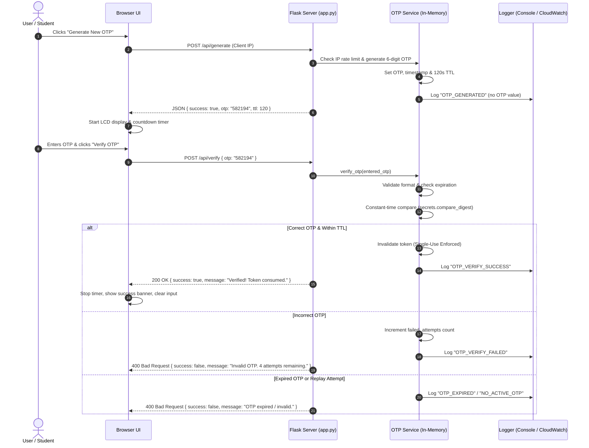

# MFA Physical Token Simulator

> **Multi-Factor Authentication & Possession-Token Laboratory**  
> *Demonstrating Cryptographically Secure OTP Generation, Expiry, One-Time Use, Security Event Logging, and AWS CloudWatch Integration.*

---

## 1. Abstract

Multi-Factor Authentication (MFA) is one of the most vital defense mechanisms in modern cybersecurity, protecting systems against credential stuffing, phishing, and password reuse attacks. This project presents a software-based **MFA Physical Token Simulator** that demonstrates how a possession-based second factor functions. The system emulates a dedicated hardware security keyfob (such as an RSA SecurID token or hardware authenticator) that generates cryptographically secure 6-digit One-Time Passwords (OTPs) governed by time-to-live (TTL) expiry and strict single-use invalidation. Built with a Python Flask REST backend, a responsive cybersecurity dashboard frontend, and an optional AWS CloudWatch Logs integration, the project provides a laboratory environment for students and engineers to explore authentication flows, replay attack prevention, and security audit logging.

---

## 2. Problem Statement

Traditional single-factor authentication (passwords or PINs) relies exclusively on the **knowledge factor** ("something you know"). Millions of passwords are compromised annually due to data breaches, weak user selection, keyloggers, and social engineering. While Multi-Factor Authentication mitigates these vulnerabilities by requiring a **possession factor** ("something you have"), students and junior developers often lack a clear, inspectable demonstration of how OTPs are generated, verified, expired, and audited on the server side. Furthermore, commercial hardware tokens operate as closed black boxes. There is a need for a clear, educational, inspectable token simulator that illustrates the end-to-end token lifecycle, defense against replay attacks, brute-force rate limiting, and enterprise cloud audit logging.

---

## 3. Project Objectives

1. **Simulate a Hardware Possession Factor:** Model an isolated hardware security token displaying a synchronized 6-digit OTP on a digital LCD screen.
2. **Implement Cryptographic OTP Generation:** Generate random 6-digit OTPs using Python's cryptographically secure pseudo-random number generator (`secrets` module).
3. **Enforce Temporal Expiry (TTL):** Implement a configurable countdown timer (default 120 seconds) after which tokens are automatically invalidated.
4. **Enforce Single-Use & Anti-Replay Policies:** Ensure that once an OTP is successfully verified, it is immediately purged from memory and cannot be reused.
5. **Mitigate Abuse and Brute-Force Attacks:** Provide generation cooldown rate limiting and account lockout after exceeding maximum failed attempts (default 5 attempts).
6. **Zero-Knowledge Security Logging:** Emit structured, security-conscious event logs to terminal, local files, and optionally AWS CloudWatch without ever leaking OTP values or secrets.
7. **Comprehensive Automated Verification:** Validate system integrity using an automated `pytest` test suite covering functional, edge-case, security, and logging requirements.

---

## 4. Existing System vs. Proposed System

| Feature | Existing Basic Implementation | Proposed MFA Simulator Lab |
| :--- | :--- | :--- |
| **User Interface** | Basic plain HTML form without timer or telemetry | Full cybersecurity dashboard with hardware token LCD, real-time timer bar, and audit stream |
| **Token Generation** | Simple random generation without rate limit | Cryptographic CSPRNG (`secrets`) with per-client IP generation cooldown |
| **Expiry Visualization** | None (user had no indication of remaining time) | Live synchronized MM:SS countdown timer with dynamic color alerts |
| **Replay Defense** | Primitive; no rate limiting or lockout protection | Strict single-use consumption + 5-attempt brute-force lockout defense |
| **API Architecture** | Basic endpoints without health check or event feeds | RESTful JSON API (`/api/generate`, `/api/verify`, `/api/health`, `/api/status`, `/api/events`, `/api/reset`) |
| **Cloud Observability** | Console print statements only | Multi-tier logging: Console + Rotating File + Optional AWS CloudWatch with fallback |
| **Automated Testing** | No automated tests | Comprehensive 19-test suite covering all 12 system conditions |

---

## 5. Technologies Used

### Frontend
- **HTML5:** Semantic markup, accessibility labels (`aria-live`, `role="alert"`), input masking.
- **CSS3:** Custom cybersecurity dashboard theme, responsive CSS Grid and Flexbox, LCD glow styling.
- **Vanilla JavaScript (ES6+):** Async/await Fetch API communication, timer interval management, DOM manipulation (no external frontend frameworks required).

### Backend
- **Python 3:** Core programming language.
- **Flask (v3.1+):** Micro web framework providing RESTful JSON APIs and static file delivery.
- **Python `secrets` Module:** Cryptographically secure pseudo-random number generation (CSPRNG) and constant-time string comparisons (`secrets.compare_digest`).
- **Python `logging` Module:** Standardized structured application telemetry.
- **`boto3` & `watchtower`:** AWS SDK and CloudWatch Logs handler for streaming logs to Amazon Web Services.
- **`pytest`:** Unit and integration testing framework.

### Cloud & Infrastructure
- **AWS CloudWatch Logs:** Centralized log aggregation and monitoring in region `ap-southeast-2`.
- **AWS IAM:** Least-privilege IAM policy definition.
- **WSGI / Gunicorn:** Production application entry point (`wsgi.py`).

---

## 6. System Architecture

```mermaid
flowchart TD
    subgraph Client["Client Tier (Web Browser)"]
        UI["Cybersecurity Dashboard UI"]
        LCD["Hardware Keyfob LCD Simulator"]
        Timer["Visual Countdown Timer"]
        Form["6-Digit Verification Form"]
        Feed["Live Security Audit Log Feed"]
    end

    subgraph Backend["Application Tier (Flask Backend)"]
        App["Flask Router (app.py)"]
        Health["Health & Status Gateway (/api/health)"]
        OTP["OTP Manager Service (otp_service.py)"]
        CSPRNG["CSPRNG Generator (secrets.randbelow)"]
        Store["Thread-Safe In-Memory Session Store"]
        Audit["Sanitized Security Event Buffer"]
    end

    subgraph Logging["Observability & Cloud Tier"]
        Logger["Central Logger (cloudwatch_logger.py)"]
        Console["Local Terminal Stream"]
        LocalFile["Rotating File (logs/mfa_simulator.log)"]
        CW["AWS CloudWatch Logs (/aws/flask/MFA-Token-Simulator)"]
    end

    UI -->|HTTP POST /api/generate| App
    UI -->|HTTP POST /api/verify| App
    UI -->|HTTP GET /api/health| App
    UI -->|HTTP GET /api/events| App

    App --> OTP
    App --> Health
    OTP --> CSPRNG
    OTP --> Store
    OTP --> Audit

    App --> Logger
    Logger --> Console
    Logger --> LocalFile
    Logger -.->|boto3 + watchtower (Optional)| CW
```

---

## 7. Application Workflow



---

## 8. API Documentation

### 1. Generate OTP
- **Route:** `POST /api/generate`
- **Headers:** `Content-Type: application/json`
- **Description:** Generates a new cryptographically secure 6-digit OTP. Enforces a 5-second per-IP cooldown rate limit.
- **Response (200 OK - Demo Mode):**
  ```json
  {
    "success": true,
    "otp": "729401",
    "ttl_seconds": 120,
    "expires_at": 1793284560.12,
    "demo_mode": true,
    "message": "OTP generated successfully. Valid for 120 seconds."
  }
  ```
- **Error (429 Too Many Requests):**
  ```json
  {
    "success": false,
    "error": "RATE_LIMIT_EXCEEDED",
    "message": "Please wait 4 second(s) before generating a new OTP."
  }
  ```

### 2. Verify OTP
- **Route:** `POST /api/verify`
- **Headers:** `Content-Type: application/json`
- **Request Body:**
  ```json
  {
    "otp": "729401"
  }
  ```
- **Response (200 OK - Successful Verification):**
  ```json
  {
    "success": true,
    "message": "OTP verified successfully! Token consumed."
  }
  ```
- **Error (400 Bad Request - Expired, Reused, or Incorrect):**
  ```json
  {
    "success": false,
    "error": "INVALID_OTP",
    "message": "Invalid OTP. 4 attempt(s) remaining."
  }
  ```

### 3. System Health Check
- **Route:** `GET /api/health`
- **Description:** Returns operational health without exposing internal paths or credentials.
- **Response (200 OK):**
  ```json
  {
    "status": "healthy",
    "timestamp": "2026-10-29T21:20:00Z",
    "demo_mode": true,
    "otp_ttl_seconds": 120,
    "rate_limit_seconds": 5,
    "max_attempts": 5,
    "cloudwatch": {
      "enabled": false,
      "status": "disabled",
      "log_group": "/aws/flask/MFA-Token-Simulator",
      "region": "ap-southeast-2",
      "message": "AWS CloudWatch logging is disabled by configuration (Local logging only)."
    }
  }
  ```

### 4. Security Audit Events
- **Route:** `GET /api/events?limit=15`
- **Description:** Returns recent sanitized security telemetry events for the dashboard event stream.
- **Response (200 OK):**
  ```json
  {
    "success": true,
    "count": 2,
    "events": [
      {
        "timestamp": "2026-10-29T21:20:05Z",
        "event_type": "OTP_VERIFY_SUCCESS",
        "message": "OTP verified successfully. Token consumed and invalidated (single-use enforced).",
        "status": "SUCCESS",
        "client_ip": "127.0.0.1"
      },
      {
        "timestamp": "2026-10-29T21:19:40Z",
        "event_type": "OTP_GENERATED",
        "message": "Cryptographically secure 6-digit OTP generated. Validity: 120s.",
        "status": "INFO",
        "client_ip": "127.0.0.1"
      }
    ]
  }
  ```

### 6. Dashboard Statistics & Telemetry
- **Route:** `GET /api/stats`
- **Description:** Returns real-time KPI metrics, active session state, hardware token details, and recent verification attempts for the dashboard.
- **Response (200 OK):**
  ```json
  {
    "success": true,
    "data": {
      "metrics": {
        "total_generated": 14,
        "total_verified": 12,
        "total_failed": 2,
        "total_expired": 1,
        "total_rate_limited": 0,
        "success_rate_pct": 85.7,
        "total_attempts": 14
      },
      "token_info": {
        "serial_number": "FOB-600-X7A-8892",
        "model": "SECURE-KEY FOB-600",
        "battery_level": "98%",
        "sync_drift": "+0.018s (Synchronized)"
      },
      "recent_attempts": [...]
    }
  }
  ```

### 7. Runtime Settings Management
- **Route:** `GET /api/settings` and `POST /api/settings`
- **Description:** Read or dynamically update operational policies (TTL duration, Rate Limit cooldown, Max verification attempts, Demo OTP display mode).

### 8. Hardware Token Clock Resync
- **Route:** `POST /api/token/resync`
- **Description:** Simulates hardware keyfob clock calibration against authoritative NTP time servers.

### 9. Clear Audit Telemetry
- **Route:** `POST /api/logs/clear`
- **Description:** Resets in-memory audit logs and authentication attempt histories.

---

## 9. Security Principles & Architecture

### 1. Cryptographically Secure Generation
Standard random number generators (e.g., Python's `random` module) use the Mersenne Twister algorithm, which is completely deterministic and predictable if internal state is observed. This simulator uses Python's `secrets` module (`secrets.randbelow(900000) + 100000`), which interfaces directly with the host operating system's cryptographic entropy source (`CryptGenRandom` on Windows, `getrandom()` on Linux).

### 2. Time-To-Live (TTL) Expiry
Every token is stamped with an expiration timestamp (`now + OTP_TTL_SECONDS`). The server validates this timestamp during verification. If the current time exceeds expiration, the token is destroyed, rejecting delayed or intercepted submissions.

### 3. Single-Use Replay Defense
In standard replay attacks, an attacker eavesdrops on an authentication transmission and re-submits the identical credential. This simulator enforces strict single-use invalidation: the moment an OTP is successfully verified, `self._current_otp` is set to `None`. Submitting the exact same OTP a second time returns an immediate HTTP 400 rejection.

### 4. Constant-Time Comparison
Comparing strings using standard equality operators (`==`) is susceptible to timing side-channel attacks, because standard comparisons exit on the first non-matching character. The simulator utilizes `secrets.compare_digest(entered_otp, current_otp)`, which executes in constant time regardless of character alignment.

### 5. Zero-Knowledge Logging
Under no circumstances are raw OTPs, submitted passwords, or AWS credential strings written to application logs. The audit logger records event types (`OTP_GENERATED`, `OTP_VERIFY_SUCCESS`) and metadata, keeping the audit trail safe for compliance review.

---

## 10. Project Directory Structure

```
MFA Physical token simulator/
│
├── .env.example             # Environment configuration template
├── .gitignore               # Git version control exclusions
├── Procfile                 # Production WSGI startup command for PaaS
├── README.md                # Comprehensive project documentation
├── DEPLOYMENT.md            # Step-by-step production deployment guide
├── requirements.txt         # Standardized Python dependencies
├── requirment.txt           # Backward-compatibility pointer
│
├── app.py                   # Main Flask application & REST API routes
├── config.py                # Environment configuration loader
├── otp_service.py           # Thread-safe OTP manager & security policies
├── cloudwatch_logger.py     # Local & AWS CloudWatch logging engine
├── wsgi.py                  # Production WSGI entry point
│
├── index.html               # Semantic cybersecurity dashboard frontend
├── style.css                # Professional responsive dark cybersecurity styling
├── script.js                # Frontend client logic, countdown timer, & telemetry
│
├── logs/                    # Local rotating log files directory (auto-created)
│   └── mfa_simulator.log
│
└── tests/                   # Automated pytest suite
    └── test_mfa.py          # 22 comprehensive unit & integration tests
```

---

## 11. Local Installation & Execution Steps (Windows PowerShell)

Follow these exact steps to run the project locally on Windows:

### Step 1: Open the Project Folder
Open Visual Studio Code, press <kbd>Ctrl</kbd> + <kbd>`</kbd> to open the integrated PowerShell terminal, and verify your directory:
```powershell
Get-Location
```

### Step 2: Create a Python Virtual Environment
```powershell
python -m venv .venv
```

### Step 3: Activate the Virtual Environment in PowerShell
```powershell
.\.venv\Scripts\Activate.ps1
```
*(If PowerShell blocks script execution due to ExecutionPolicy, run: `Set-ExecutionPolicy -Scope Process -ExecutionPolicy RemoteSigned`)*

### Step 4: Install Dependencies
```powershell
pip install -r requirements.txt
```

### Step 5: Create Local Environment Configuration
Copy `.env.example` to `.env`:
```powershell
Copy-Item .env.example .env
```
*(By default, `CLOUDWATCH_ENABLED=0`, which means the application works out-of-the-box locally with zero AWS setup).*

### Step 6: Run the Flask Application
```powershell
python app.py
```
You will see output indicating the server has started:
```
[2026-10-29 21:25:00] [INFO] [mfa_simulator]: Local logging active. CloudWatch logging disabled.
[2026-10-29 21:25:00] [INFO] [mfa_simulator]: Starting MFA Token Simulator on port 5000 (Debug: False)
 * Running on http://127.0.0.1:5000
```

### Step 7: Open in Your Browser
Open your browser and navigate to:
```
http://127.0.0.1:5000
```

---

## 12. Automated Test Execution

The project includes an automated test suite verifying all 12 system conditions specified in the project requirements.

To run the tests:
```powershell
pytest -v
```

### Test Coverage Summary:
- `test_home_page_loads_successfully`: Verifies HTTP 200 and frontend delivery.
- `test_static_css_and_js_serve`: Verifies static stylesheet and script delivery.
- `test_health_endpoint_works`: Verifies health check metadata without leaking secrets.
- `test_status_endpoint`: Verifies non-sensitive session state reporting.
- `test_otp_generation_demo_mode`: Verifies 6-digit CSPRNG token creation.
- `test_otp_generation_non_demo_mode`: Verifies token masking when demo mode is disabled.
- `test_correct_otp_verification_succeeds`: Verifies successful validation.
- `test_incorrect_otp_is_rejected`: Verifies rejection of non-matching codes.
- `test_malformed_otp_rejected`: Verifies rejection of letters, symbols, short/long inputs.
- `test_missing_otp_handled_correctly`: Verifies 400 response on empty payloads.
- `test_verification_without_active_otp`: Verifies clean rejection when no token is active.
- `test_expired_otp_is_rejected`: Verifies temporal TTL expiry enforcement.
- `test_successfully_verified_otp_cannot_be_reused`: Verifies strict single-use replay defense.
- `test_max_failed_attempts_lockout`: Verifies token invalidation after 5 failed attempts.
- `test_rate_limits_behave_as_expected`: Verifies HTTP 429 response on rapid generation calls.
- `test_cloudwatch_disabled_mode_works_without_credentials`: Verifies local fallback.
- `test_cloudwatch_init_failure_does_not_crash_app`: Verifies application resilience during AWS errors.
- `test_security_audit_events_endpoint`: Verifies sanitized audit trail generation.
- `test_reset_session_endpoint`: Verifies session reset capabilities.
- `test_dashboard_stats_endpoint`: Verifies real-time KPI metrics and hardware token telemetry.
- `test_settings_get_and_post`: Verifies reading and dynamically updating operational settings.
- `test_token_resync_and_clear_logs`: Verifies token drift calibration and audit log clearing.

---

## 13. Optional AWS CloudWatch Integration Setup

When you are ready to stream application logs to AWS CloudWatch Logs:

### Step 1: Configure AWS CLI on Your Machine
```powershell
aws configure
```
Provide your AWS Access Key, Secret Key, and default region `ap-southeast-2`.

### Step 2: Minimum IAM Permissions Policy
Create an IAM Policy named `MFA-Token-Simulator-CloudWatch-Policy`:
```json
{
  "Version": "2012-10-17",
  "Statement": [
    {
      "Sid": "AllowCloudWatchLogsPut",
      "Effect": "Allow",
      "Action": [
        "logs:CreateLogGroup",
        "logs:CreateLogStream",
        "logs:PutLogEvents",
        "logs:DescribeLogStreams"
      ],
      "Resource": [
        "arn:aws:logs:ap-southeast-2:*:log-group:/aws/flask/MFA-Token-Simulator",
        "arn:aws:logs:ap-southeast-2:*:log-group:/aws/flask/MFA-Token-Simulator:*"
      ]
    }
  ]
}
```

### Step 3: Enable CloudWatch in `.env`
Update `.env`:
```ini
CLOUDWATCH_ENABLED=1
CLOUDWATCH_LOG_GROUP=/aws/flask/MFA-Token-Simulator
CLOUDWATCH_LOG_STREAM=simulator-flask-stream
AWS_DEFAULT_REGION=ap-southeast-2
```

### Step 4: Restart Flask & Inspect Logs in AWS Console
1. Restart `python app.py`.
2. Open the [AWS CloudWatch Console](https://console.aws.amazon.com/cloudwatch).
3. Select region `ap-southeast-2` (Sydney).
4. Navigate to **Logs** -> **Log groups** -> `/aws/flask/MFA-Token-Simulator`.
5. Open log stream `simulator-flask-stream` and observe live security event streaming.

---

## 14. Limitations & Future Enhancements

- **Single-Process In-Memory Store:** The current session store is held in memory for single-instance educational demonstrations. In a distributed multi-container deployment, replace `self._current_otp` with an **AWS ElastiCache (Redis)** or **Amazon DynamoDB** table with native TTL expiration.
- **SMS / Email Transmission:** In production MFA, OTPs are transmitted out-of-band via SMS (AWS SNS), Email (AWS SES), or generated on-device via RFC 6238 TOTP (Time-based One-Time Password algorithm). The browser display in this simulator is an educational replica of an isolated physical keyfob screen.
- **FIDO2 / WebAuthn:** Modern authentication is shifting towards passwordless public-key cryptography (FIDO2 / Passkeys). Future versions can integrate WebAuthn API endpoints.

